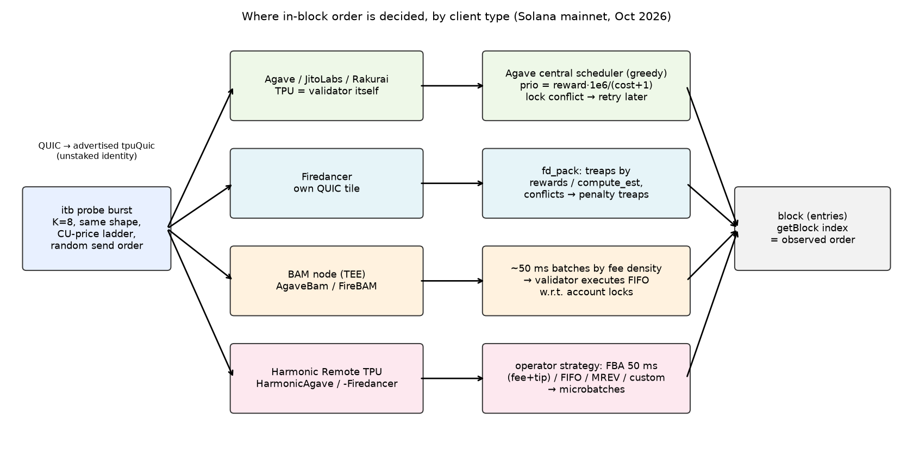
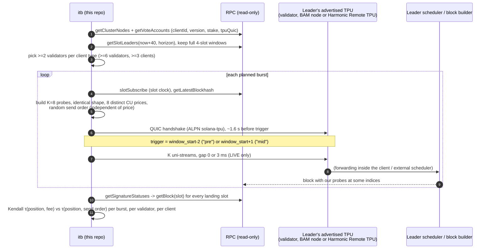

# Inside the Block: how Solana leaders order transactions (post-Alpenglow measurement kit)

This repo answers one question for each validator it measures: **by what rule does this leader order transactions inside its block?** It sends its own probe transactions straight into chosen leaders' windows on **Solana mainnet**, finds them in the produced blocks, and tests whether block position follows **fee**, **arrival**, or **neither**.

* One command: `docker compose up --build`. This is a **dry run** by default: it plans, builds, signs, times and opens a QUIC connection to each leader's TPU, and it sends nothing.
* Real sends happen only with `ITB_LIVE=1`. Every fee lamport is reserved against a **spend cap** first. The cap defaults to 0.05 SOL, and the code refuses to go higher.
* All raw data (signatures, slots, block positions, compact block tables) lands in `data/`. Judges can check every claim with `getBlock`/`getTransaction`.
* All measurements are **after Alpenglow**: the code refuses slots below `459,653,000`, the first Alpenglow-consensus slot ([solana.com/upgrades/alpenglow](https://solana.com/upgrades/alpenglow)).

The results and the dated measurement log are in [`REPORT.md`](REPORT.md). **Mainnet live results: REPORT §5** and [`data/live-mainnet-pooled/tables.md`](data/live-mainnet-pooled/tables.md).

---

## 1. Quick start

```bash
# 0) zero-spend: who runs what right now (clientId/version/stake from gossip)
docker compose run --rm itb snapshot

# 1) one-command reproduction. DRY-RUN: no transaction byte is written
docker compose up --build            # -> data/runs/<UTC-timestamp>/ {plan,sends,landed,results}.json, tables.md, png

# 2) live campaign (spend-capped). Put a funded keypair at ./keys/payer.json (never committed; .gitignore'd)
ITB_LIVE=1 ITB_MAX_SPEND_SOL=0.05 docker compose up --build

# 3) supplementary passive survey of other people's txs (zero-spend)
docker compose --profile passive run --rm passive

# 3b) re-check every landed probe's slot, index and leader against RPC (no keys, no sends)
docker compose run --rm itb verify /data/runs/<run-id>

# 4) recompute every statistic offline from committed raw data
docker compose --profile analyze run --rm analyze
# 4b) pool several live runs (per producing client x arm) -> data/live-mainnet-pooled/
docker compose run --rm --entrypoint python itb -m itb.pool /data/live-mainnet-pooled /data/runs/20261023T144945Z /data/runs/20261023T155226Z

# 5) unit tests (tx shape, spend cap, parsers incl. v1 transactions, statistics)
docker compose --profile test run --rm tests
```

You can set `ITB_RPC_URL` to any mainnet RPC. The public endpoint works, but it rate-limits and drops WebSockets about once a minute (see REPORT, "what went wrong"). Query strings are never logged, so an `?api-key=` stays private.

**Troubleshooting.** If the container cannot resolve the RPC host (`Temporary failure in name resolution`), your Docker daemon's DNS cannot reach your resolver. Run with host networking: `printf 'services:\n  itb:\n    network_mode: host\n' > hostnet.yml && docker compose -f docker-compose.yml -f hostnet.yml up --build`.

Without Docker: `pip install -r requirements.txt && python -m itb --data data all`.

## 2. The experiment in one picture





## 3. Why this design

### 3.1 Probe transaction

`SetComputeUnitLimit(20 000)`, `SetComputeUnitPrice(p)`, and an SPL Memo v2 with a fixed 40-byte tag `itb|<run>|<burst>|<k>....`.

* **All K probes in a burst are byte-for-byte the same size** with the same instructions, the same CU limit, one signature and one writable account (the fee payer). Only the CU price `p` differs. So the probes have identical cost under each client's documented cost model, and **every fee-density rule ranks them exactly by `p`**:
  * Agave: `priority = reward·10⁶/(cost+1)`, where `reward` is the priority fee plus the leader's share of the signature fee ([`core/src/transaction_priority.rs` @ v4.3.2](https://github.com/anza-xyz/agave/blob/v4.3.2/core/src/transaction_priority.rs)).
  * Firedancer pack: `rewards/compute_est` ([`fd_pack.c`](https://github.com/firedancer-io/firedancer/blob/main/src/disco/pack/fd_pack.c)).
  * BAM: "ordering by fee density" ([bam.dev blog](https://bam.dev/blog/introducing-bams-maker-priority-plugin-sub-slot-deterministic-execution-for-onchain-market-making/)).
* The CU prices are a geometric ladder of 8 values from 1 000 to 200 000 µ-lamports/CU. A probe costs at most 5 000 + 4 000 lamports.
* **No Jito tip, no bundle, no tip account touched.** Bundles and tips are out of scope.
* Memo makes every probe self-identifying on any explorer.

### 3.2 Arms (cycled over each validator's windows)

| arm | payer | trigger | send gap | what it isolates |
|---|---|---|---|---|
| `shared:pre:0` | one payer for all 8, so every pair conflicts on the payer write lock | 2 slots before the window | 0 ms | Pure **priority rule** when the scheduler has all 8 in its buffer before the slot starts and has to **serialize** them |
| `independent:pre:0` | 8 different payers, no conflicts | 2 slots before | 0 ms | Same buffered set, but the txs can run **in parallel** on different worker threads. Does the order survive parallel execution? |
| `shared:mid:0` | shared | 2nd slot of window | 0 ms | Rule while the leader is already busy with live flow |
| `independent:mid:3` | independent | 2nd slot | 3 ms | **Arrival (FIFO) vs fee** when the scheduler is consuming continuously; 3 ms gaps make arrival order ≈ send order |
| `shared:pre:3`, `independent:mid:0` | | | | Cross-checks |

Send order is a random permutation of the price ladder, drawn from a seeded RNG that is recorded in `meta.json`. So by construction **send rank and fee rank are independent**, and the two hypotheses make opposite predictions about the same data.

### 3.3 Statistics

For each burst we compute Kendall τ between global position `(slot, index)` and

* **−price**: τ_fee = +1 means strictly highest-fee-first.
* **send rank**: τ_send = +1 means strictly first-sent-first.

We also record:

* the share of concordant pairs;
* the span inside the block, and how many **foreign** transactions sit between our probes;
* the landing rate;
* whether probes landed inside the targeted 4-slot window.

Per validator × arm and per client we report the mean τ with a bootstrap 95% CI and a burst-level sign test.

The verdict is one of: `fee-priority` (CI of τ_fee entirely > 0.3, τ_send not), `arrival order/FIFO` (the mirror case), `mixed`, or **`no rule detected`**, which is a legitimate result. "How strictly" is the share of bursts that are perfectly sorted, plus the size of τ.

## 4. What you will have to account for, and how we handle each point

| Point | How the design handles it |
|---|---|
| **Leader schedule & leader types** | `getSlotLeaders` for the next `horizon` slots. Only **full 4-slot windows** are used. The leader span is still 4 slots after the 200 ms slot change ([solana.com/upgrades/reduced-slot-times](https://solana.com/upgrades/reduced-slot-times)). Client/fork is taken from the gossip **`clientId`** + `version` at measurement time and saved in `cluster_snapshot.json` (Agave, JitoLabs, AgaveBam, HarmonicAgave, Firedancer, HarmonicFiredancer, FireBAM, Rakurai, Raiku…). Minimum stake is 50k SOL, so the validator gets regular windows. Up to 2 validators per client type, which gives ≥6 validators over ≥3 clients (enforced). |
| **Path from our backend to the executing node** | We send **directly to the leader's advertised `tpuQuic`** (QUIC, ALPN `solana-tpu`, self-signed Ed25519 cert, one tx per uni-stream), with **no RPC `sendTransaction`**. That removes RPC retry/forwarding loops and fan-out to other leaders. We record the TPU address and flag `tpu_proxied` (TPU IP ≠ gossip IP). On 2026-10-23, **every** AgaveBam/FireBAM/Harmonic validator with ≥50k SOL advertised a proxied TPU. That matches the docs: BAM nodes receive txs over QUIC and send ordered microblocks to the validator ([bam.dev/overview](https://bam.dev/overview/)), and Harmonic validators designate a Remote TPU ([docs.harmonic.gg](https://docs.harmonic.gg/concepts/harmonic-architecture)). For those clients we are therefore measuring the **external builder's** rule, which is the rule that decides their block. |
| **Stake-weighted QoS** | Our connection is **unstaked**, like any ordinary user's. Unstaked traffic gets a small share of TPU capacity ([solana.com SWQoS guide](https://solana.com/developers/guides/advanced/stake-weighted-qos)), so under load it is dropped first. This lowers the landing rate and can cause **selection** effects. We report sent→landed per burst and never treat missing probes as "ordered last". |
| **Interaction of our own txs with each other** | This is the reason for the two payer modes. The *shared* payer forces serialization through the account-lock path (Agave's default `BlockProductionMethod::CentralSchedulerGreedy` ([`core/src/validator.rs`](https://github.com/anza-xyz/agave/blob/v4.3.2/core/src/validator.rs)) with 4 workers by default (`DEFAULT_NUM_WORKERS`, `core/src/banking_stage.rs`): `UnschedulableConflicts` → retried in priority order ([`greedy_scheduler.rs`](https://github.com/anza-xyz/agave/blob/v4.3.2/core/src/banking_stage/transaction_scheduler/greedy_scheduler.rs)); Firedancer: penalty treaps). *Independent* payers let the scheduler batch them onto parallel workers, where commit order to the ledger is decided by worker timing. On localnet this difference alone flips the result (REPORT §3). |
| **Competition inside the block** | Prices span 1k–200k µ-lamports/CU, which covers the range most mainnet txs pay (see passive survey). We record each probe's index, the block size, and the number of foreign txs between probes. Within-burst ranking is unaffected by the absolute level, because all probes share the same competitors. |
| **Send order** | It is randomized and independent of fee by construction. It is sent over a single QUIC connection (in-order send; QUIC can still reorder under loss). With gap 3 ms the arrival order is ≈ send order. With gap 0 all 8 arrive within ~1 ms, so arrival order carries no information and only a fee rule can produce order. |
| **Noise vs rule** | Many bursts per validator, bootstrap CIs, and an explicit `no rule detected` verdict. Our passive survey of ~40 blocks shows the **global** block order is barely correlated with fee (|ρ| < 0.4 on every client). So a rule, if any, is local, and we look at our own 8-tx clusters, not at whole blocks. |
| **Leader-window timing** | Slots are 200 ms now. The slot clock is `slotSubscribe` with `getSlot` polling as a fallback. `pre` = observed slot `first-2`. Agave **holds** packets instead of forwarding when the node is <2 slots from its leader slot (and forwards-and-holds below 20) ([`decision_maker.rs`](https://github.com/anza-xyz/agave/blob/v4.3.2/core/src/banking_stage/decision_maker.rs); constants in `solana-clock`). So probes sent at `first-2` are buffered and seen together at slot start. If the clock jumps past the allowed slot (e.g. a WebSocket reconnect), the burst is **skipped, not sent late**. |
| **Alpenglow** | Measurements are post-Alpenglow only: the code refuses slots below 459,653,000. The block format still exposes order through `getBlock`. Votes are no longer transactions under Alpenglow (Votor), so indices count only user transactions. |
| **Transaction v1** | Blocks contain v1 transactions (budget in `message.transactionConfig`, `priorityFee` in lamports total; [SIMD-0385](https://github.com/solana-foundation/solana-improvement-documents/blob/main/proposals/0385-transaction-v1.md)). The parser handles legacy, v0 and v1. Our probes are v0. |

## 5. What this design does NOT separate (read before believing a verdict)

1. **Scheduler rule vs network/ingress order.** A FIFO-looking result at gap 3 ms could come from a FIFO scheduler *or* from a fee scheduler that consumes packets as they arrive (no batching). The `pre`/gap-0 arms are the control: a fee scheduler must sort those, while a FIFO one cannot because their arrival order is noise.
2. **External builder vs validator.** For BAM/Harmonic validators we cannot tell the builder's ordering apart from the validator's executor ordering. Both docs say the validator executes received batches in order ([bam.dev/validators](https://bam.dev/validators/): "FIFO order with respect to account locks"), so we attribute the result to the builder. Harmonic also lets each operator pick a strategy: 50 ms FBA (batches ordered by descending priority fees and tips), FIFO (continuous arrival order), MREV, or a custom scheduler ([docs.harmonic.gg/concepts/scheduling-strategies](https://docs.harmonic.gg/concepts/scheduling-strategies)). The **strategy is not visible on-chain**, so two HarmonicAgave validators can legitimately disagree.
3. **Parallel execution vs ordering.** The block order is the order in which entries were recorded. Several worker threads record concurrently, and `getBlock` does not expose entry boundaries. An "unsorted" independent-payer burst can therefore mean "sorted at the scheduler, raced at execution". The shared-payer arm is our best handle on this.
4. **Self-reported client labels.** `clientId`/`version` come from gossip and are not proven. A modified node can claim anything.
5. **Unstaked path only.** Staked senders (SWQoS) or paid relays may see a different ingress path and different drops.
6. **Small n per validator.** Each validator has only a few windows per campaign. Per-validator verdicts are weaker than per-client ones; all CIs are reported.
7. **Absolute position vs other users.** We do not claim *why* a foreign tx sits before ours: we do not know its arrival time. Foreign-tx data is supplementary only.

## 6. Engineering

* `itb/experiment.py`: planner, burst executor, funding/sweep of 8 ephemeral fee payers. Their keys are written to the run dir as `*.SECRET.json`, which is git-ignored, so funds can be recovered after a crash. A sweep runs only after the last blockhash has expired.
* `itb/budget.py`: `SpendCap`. It is an append-only, fsync'd ledger, so the cap survives restarts and spans the whole campaign. Hard ceiling: 0.05 SOL. Worst-case fees for the **whole plan** are checked before anything is funded, and each burst reserves its worst case before it is signed for sending. The ephemeral payers' rent-exempt deposits are returned in the sweep and never spent.
* `itb/quic_sender.py`: a ~100-line TPU-QUIC client on `aioquic`.
* `itb/slots.py`: slot clock (WebSocket + polling fallback).
* `itb/collect.py`, `itb/blockparse.py`: landing lookup and compact per-tx block tables, gzip JSONL, covering **all** txs in each landing block.
* `itb/analyze.py`, `itb/stats.py`: τ, CIs, verdicts, `tables.md`, `tau_by_client.png`. Bursts are attributed to the **leader that actually produced the block** (`landed_leader` from `getSlotLeaders`), because many probes are forwarded past the targeted window.
* `itb/pool.py`: pools several live runs into one per-client × arm table.
* `itb/passive.py`: zero-spend survey.
* Logging goes to stdout (docker logs) at INFO with UTC timestamps.

Keys: `./keys/payer.json` is mounted **read-only** at `/keys`, or you can pass `ITB_PAYER_KEYPAIR_JSON`. Never commit keys; `keys/` and `*.SECRET.json` are git-ignored.

### Suggested development path (as in the brief)

| stage | command | cost |
|---|---|---|
| localnet | `solana-test-validator` + `python -m itb --rpc http://127.0.0.1:8899 run --localnet --live --no-memo --payer <kp>` then `collect`, `analyze` | free |
| mainnet dry-run | `docker compose up` | free |
| mainnet live | `ITB_LIVE=1 docker compose up` | ≤ 0.05 SOL in fees (planned worst case is printed and checked first) |
