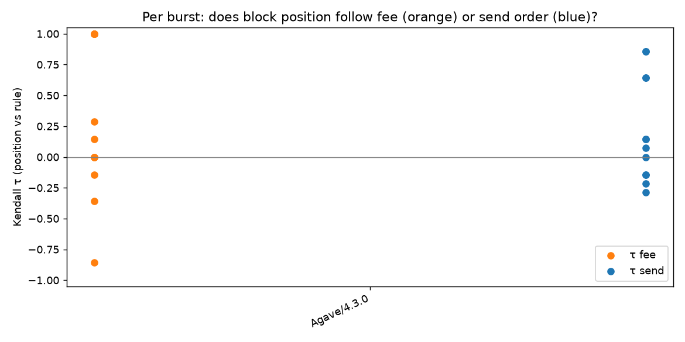

# REPORT: measurements, results, and what went wrong

Every measurement is dated in UTC (Kyiv = UTC+3 until 25 Oct 2026, then UTC+2). Raw data for every row below is in `data/`. You can recompute every statistic offline with `docker compose --profile analyze run --rm analyze`, or for a single dataset with `python -m itb.reanalyze data/<dataset>`.

> **Status (2026-10-23):** the pipeline is complete and validated on localnet (live sends) and on mainnet (dry run, real leader schedule, real QUIC handshakes). **The mainnet live campaign has not been run yet.** It needs a funded fee payer (worst case ≈ 0.007 SOL in fees for the default 96-burst plan, under the 0.05 SOL cap). When it runs, its run directory, `tables.md` and `tau_by_client.png` will be added here as §5. Every result is post-Alpenglow (slots ≥ 459,653,000).

## 1. Measurement log

| # | when (UTC) | network / slots | what | raw data |
|---|---|---|---|---|
| M1 | 2026-10-23 10:14 | mainnet, slots 460,398,910 – 460,404,910 (post-Alpenglow, 200 ms slots) | cluster snapshot + passive survey of 43 blocks from 14 client/version groups (zero spend) | `data/passive-2026-10-23/` |
| M2 | 2026-10-23 10:17 – 10:20 | `solana-test-validator` (Agave 4.3.0), one leader | **live** pipeline test: 12 bursts × 8 probes, all 6 arms, seed 11 | `data/localnet/runs/20261023T101730Z/` |
| M2b | 2026-10-23 10:47 – 10:49 | same localnet | replication: 6 bursts (one per arm), seed 23, then `itb verify` | `data/localnet/runs/20261023T104750Z/` (+ `verify.json`) |
| M3 | 2026-10-23 10:24 – 10:35 | mainnet, windows at slots 460,408,012 – 460,410,804 | **dry run**: 14 bursts planned on 8 validators × 8 client types; probes signed, QUIC handshake made at the trigger slot, nothing sent | `data/dryrun/runs/20261023T102447Z/` |
| M4 | 2026-10-23 10:40 – 10:46 | mainnet, 1 500-slot horizon | `ITB_HORIZON_SLOTS=1500 ITB_BURSTS_PER_VALIDATOR=1 ITB_SEED=7 docker compose up --build` (dry run): 14 validators on 7 client types, run → collect → analyze in one command, exit 0 | `data/dryrun/runs/20261023T104048Z/` |

Cluster composition at M1, by stake share. Source: gossip `clientId` from `getClusterNodes`, joined with `getVoteAccounts`; file `cluster_snapshot.json`.

| Client | Version | Stake |
|---|---|---|
| AgaveBam | 4.3.2 | 36.2% |
| HarmonicAgave | 4.3.2 | 23.3% |
| JitoLabs | 4.3.2 | 21.8% |
| HarmonicFiredancer | 26.10.4 | 6.5% |
| Firedancer | 26.10.4 | 6.1% |
| FireBAM | 26.10.4 | 1.6% |
| JitoLabs | 4.3.0 | 1.4% |
| Rakurai | 4.3.2 | 1.2% |
| Agave | 4.3.2 | 1.0% |
| Raiku | 4.3.2 | 0.08% |

Among validators with ≥50k SOL stake, **every** AgaveBam (348), HarmonicAgave (57), HarmonicFiredancer (26) and FireBAM (12) node advertises a TPU IP that differs from its gossip IP. JitoLabs nodes mostly do not (111/121), and neither do Agave, Rakurai and Firedancer nodes. So about two thirds of stake receives transactions at an external builder, not at the validator.

## 2. M1: passive survey (supplementary, other people's transactions)

For each block we computed Spearman ρ between a transaction's index and its Agave priority density (`reward·10⁶/(costUnits+1)`, using `meta.costUnits`; this covers legacy, v0 and **v1** transactions). Negative ρ means higher priority sits earlier.

| client/version | blocks | ρ(index, priority) | ρ local (32-tx windows) | mean rel. position of top-10% priority | share zero-priority |
|---|---|---|---|---|---|
| Agave/4.3.2 | 4 | −0.06 | −0.01 | 0.44 | 27% |
| AgaveBam/4.3.2 | 4 | −0.16 | −0.12 | 0.46 | 27% |
| FireBAM/26.10.4 | 4 | −0.04 | −0.21 | 0.53 | 22% |
| Firedancer/26.10.4 | 4 | −0.24 | −0.08 | 0.38 | 29% |
| HarmonicAgave/4.3.2 | 4 | −0.10 | −0.02 | 0.45 | 31% |
| HarmonicFiredancer/26.10.4 | 4 | −0.07 | −0.08 | 0.44 | 28% |
| JitoLabs/4.3.2 | 4 | −0.00 | −0.09 | 0.54 | 31% |
| Rakurai/4.3.2 | 3 | −0.06 | −0.03 | 0.48 | 26% |

(Single-block groups such as Firedancer/26.10.3 at −0.37 are in `passive_metrics.json`.)

**Reading.** On every client, block position is at most weakly related to fee across the whole block (|ρ| ≤ 0.24, n = 3–4 blocks). This is expected for continuous schedulers. A transaction can only be ordered against what has already arrived, so slot-level order is mostly **arrival time**, with fee deciding only *within* each scheduling batch. Firedancer and AgaveBam lean most toward fee order. **This survey cannot separate rule from arrival**, because we do not know when other people's transactions arrived. That is why the primary evidence must come from our own probes.

## 3. M2: localnet, live (Agave 4.3.0 central scheduler)

96/96 probes landed, all in the targeted slot, as indices 1–8 of a 9-transaction block.

| arm | bursts | τ fee (95% CI) | τ send (95% CI) | verdict |
|---|---|---|---|---|
| shared:pre:0 | 2 | **1.00** [1.00, 1.00] | −0.04 | fee-priority, 100% of bursts perfectly fee-sorted |
| shared:mid:0 | 2 | **1.00** [1.00, 1.00] | −0.07 | fee-priority, 100% perfectly fee-sorted |
| independent:pre:0 | 2 | −0.07 [−0.14, 0.00] | −0.04 | no rule detected |
| independent:mid:0 | 2 | 0.21 [0.14, 0.29] | −0.07 | no rule detected |
| independent:mid:3 | 2 | 0.00 | **0.75** [0.64, 0.86] | arrival / FIFO |
| independent:pre:3 | 2 | −0.61 | **0.75** [0.64, 0.86] | arrival / FIFO (the τ_fee value is an artifact of the 2 random permutations) |

**What this shows about the Agave scheduler** (and about the instrument):

1. **When our transactions conflict** (shared payer, so every pair needs the same write lock), Agave orders them **strictly by priority**: τ = 1 in 4/4 bursts, whatever the send order. This matches `greedy_scheduler.rs`: the highest priority is popped first, and conflicting transactions wait and are retried in priority order.
2. **When they don't conflict**, a burst that arrives together is spread over worker threads, and record order is **thread race** (τ ≈ 0). The fee rule is still applied when work is handed out, but it is **not visible** in block order. This is a key caveat for mainnet: an "unordered" result on independent payers does **not** mean "no fee rule".
3. **When probes arrive 3 ms apart**, the scheduler consumes them as they come and order follows **arrival** (τ_send 0.75). It cannot sort what it has not received yet.
4. The pooled `all:all` row (τ_fee 0.26 [−0.08, 0.60]) mixes these regimes and is meaningless. Verdicts are only reported per arm.

**Replication (M2b, seed 23, 6 bursts, 48/48 landed).**
* `shared:pre:0` and `shared:mid:0` gave τ_fee = **1.00** again, so conflicting probes sent together were fee-sorted in **6/6** bursts across both runs.
* `independent:*:0`: τ_fee −0.14 / +0.14, i.e. no order.
* `independent:mid:3`: τ_send **0.86**, i.e. arrival order.
* `shared:pre:3` came out **mixed** (τ_fee 0.71, τ_send 0.79). With 3 ms gaps and a shared lock, each probe that arrives while an earlier one is still locked waits, and the waiting set is re-sorted by fee. So the result is a blend of arrival and priority, exactly what a greedy scheduler with conflict retry predicts.

`python -m itb verify` re-fetched every landed slot with `getBlock` and `getSlotLeaders`: **48/48 signatures sit at the recorded index in a block produced by the targeted leader.** Judges can run the same check on the mainnet campaign (`docker compose run --rm itb verify /data/runs/<id>`) using only a public RPC.

Limits of localnet: there is one always-leader node, no competition, no forwarding, and no pre-window buffering (it is always the leader). The `pre` vs `mid` distinction can only be tested on mainnet.

## 4. M3/M4: mainnet dry run

* Plan (M3): 14 bursts. Targets: Firedancer `DNVZMSqe…`, HarmonicAgave `FzQqaDSt…`, Rakurai `ana2y2Yv…`, FireBAM `9jxgosAf…`, AgaveBam `GQzMeEMw…`, JitoLabs `bitHUmbK…`, Agave `5Us18hLZ…` and HarmonicFiredancer `HnrXmm65…`. That is 8 validators on 8 client types, all ≥ 467k SOL stake. Worst-case fee: 0.001053 SOL.
* Timing: **13/14 bursts hit their exact trigger slot.** `slot_at_send == trigger_slot`, measured 0.04–0.13 ms after the slot notification. **1/14 was skipped** by the late-trigger guard: the public WebSocket dropped, the polling fallback saw the slot 11 slots late, and the burst was not sent (§6).
* QUIC to every leader's advertised TPU (5 of the 8 are proxied): handshakes succeeded with ALPN `solana-tpu`, taking 87–414 ms. The highest latencies were at the Harmonic remote TPUs.
* Observed slot time: 189–219 ms (median ≈ 207 ms), consistent with the 200 ms slot target ([SIMD-0525 / reduced slot times](https://solana.com/upgrades/reduced-slot-times)).
* M4 (`docker compose up --build`): 14 bursts on 14 validators (2 each for AgaveBam, FireBAM, Firedancer, HarmonicAgave, HarmonicFiredancer, JitoLabs, Rakurai). There was no Agave-labelled leader window inside the short 1 500-slot horizon; the default 20 000-slot horizon covers it. 13/14 hit the exact trigger slot with a QUIC handshake of 19–220 ms. 1/14 (a Rakurai node) timed out on the QUIC handshake and was recorded as `connect_or_send_failed`; this is the kind of drop the report counts and never imputes.

## 5. Mainnet live campaign: PENDING

To be filled in by `ITB_LIVE=1 docker compose up --build`: the per-validator/arm/client tables, `tau_by_client.png`, and every probe signature with its slot and index. Each claim can then be checked with `getBlock(slot, {maxSupportedTransactionVersion: 1})`.

**Pre-registered predictions** (written before any mainnet data, so the analysis is not tuned afterwards):

| client | `shared:pre:0` (all buffered, conflicting) | `independent:mid:3` (staggered) |
|---|---|---|
| Agave / JitoLabs / Rakurai | fee order (τ_fee ≫ 0) if the probes are held until the slot starts; Rakurai's tip-based "virtual priority" does not apply (no tips) | arrival |
| Firedancer | fee order (pack treaps by rewards/CU; conflicts go to penalty treaps) | arrival, or within-microblock fee order |
| AgaveBam / FireBAM | fee order **within each ~50 ms batch**. All 8 probes fall in one batch, so expect τ_fee ≫ 0 | the 3 ms gaps still fit one 50 ms batch, so expect **fee order**, not FIFO. This is the clearest distinguishing test vs Agave |
| HarmonicAgave / HarmonicFiredancer | default FBA: like BAM; FIFO-strategy operators: τ_send > 0 even at gap 0 | FBA: fee; FIFO: arrival |

"No rule detected" for a validator stays a valid result. With unstaked QUIC some probes may be dropped. Missing probes are reported, never imputed.

## 6. What went wrong (and what we changed)

1. **v1 transactions broke block fetching.** `getBlock` with `maxSupportedTransactionVersion: 0` failed with `-32015` on post-Sep-2026 blocks (v1 txs went live in epoch 1035, [SIMD-0385](https://github.com/solana-foundation/solana-improvement-documents/blob/main/proposals/0385-transaction-v1.md)). Fix: request version 1, and read the compute budget from `message.transactionConfig` (total `priorityFee` in lamports, not µ-lamports/CU). Errors like this are now `fatal` and not retried 6 times.
2. **We assumed 400 ms slots.** The first design used `lead_slots=1`, which at 200 ms slots leaves no slack. We measured ~207 ms/slot, moved to `lead_slots=2` (≈ 400 ms of buffering, still within Agave's "hold" zone), and start preparation 8 slots ahead.
3. **The public WebSocket drops about every 60 s** (`1002 protocol error`). The first version crashed in `wait_for` after a fixed 120 s timeout. Now the timeout is proportional to distance, there is a polling fallback with reconnect, a `try/except` per burst, and a **late-trigger guard**: if the clock is already past the trigger slot, the burst is skipped and recorded as `late_trigger_skipped`, never sent late. This cost 1/14 bursts in M3.
4. **Sweep race on localnet.** The first sweep of the ephemeral payers ran while probes were still valid, and failed for lack of funds. The sweep now waits until the last used blockhash has expired (~30 s under 200 ms slots). Localnet funds were recovered by hand.
5. **Preflight right after funding** reported "no prior credit". Fixed with `preflightCommitment: confirmed`.
6. **The localnet validator ships without the Memo program.** Added `--no-memo` (a 0-lamport self-transfer of identical shape).
7. **A reporting bug:** the "perfectly sorted" share used `== 1.0` on floats and printed 0% for τ = 1.00 bursts. Fixed with `>= 0.999`. All tables were regenerated from raw data.
8. **Docker DNS in our sandbox.** The first two `docker compose up` attempts (10:38 and 10:39 UTC) failed in `getClusterNodes` with `Temporary failure in name resolution`: the compose network's embedded DNS could not reach the sandbox's resolver. We reran with a local override that sets `network_mode: host` (not committed, because it is environment-specific; see README troubleshooting). The failed attempts produced no data and were deleted.
10. **The Memo v2 program was not on mainnet.** Our first live attempt (pilot run `20261023T144637Z`, 14:46–14:48 UTC) built probes with an SPL Memo v2 instruction (`MemoSq4g…`). `getAccountInfo` returned `null` for that address, and every probe that reached a leader was recorded as a fee-only failed transaction (`ProgramAccountNotFound`): 24 probes in 3 blocks, which cost about 0.00014 SOL. Localnet had not caught this, because localnet ran with `--no-memo`. We stopped the run after 6 bursts, swept the 8 ephemeral payers back (8 signatures in that run's `sweep_sigs.json`), and switched the probes to Memo v1 (`Memo1UhkJRfHy…`, executable, 638 CU for our 40-byte tag; checked with `simulateTransaction` before relaunching). The pilot data is kept and analysed, but it is not pooled with the main runs, because failed-load transactions may follow a different path.
11. **Over-provisioned ephemeral payers.** The first funding formula gave every one of the 8 ephemeral payers enough for all shared-payer bursts. That parks ~0.04 SOL for an 82-burst plan, more than the wallet held. Now payer 0 gets the shared-arm budget and the other payers get one probe per burst (about 0.0155 SOL parked; all of it swept back at the end).
12. **Probes are often forwarded to a later leader.** Only part of the landed bursts landed in the targeted 4-slot window. The rest landed 2–140 slots later (and once 1 slot early) in blocks produced by a *different* leader. This happened mostly behind Harmonic and BAM remote TPUs and on Firedancer. Attributing those bursts to the targeted client would be wrong. `collect` now records `landed_leader` from `getSlotLeaders` for every probe, and the analysis groups bursts by the **client of the leader that actually produced the block**. `verify` checks both the targeted leader and the recorded producer.
13. **Bursts are executed serially, so some were missed.** If one burst waits on a slow QUIC handshake or a slot-clock stall, the next burst's preparation point can already be gone (`missed_trigger_before_start`), or the slot clock times out (`error: TimeoutError`). The public WebSocket also dropped often, so the late-trigger guard skipped bursts (`late_trigger_skipped`). These bursts were never sent late and are counted, not imputed.
14. **Not a bug, a limit:** the passive survey cannot tell rule from arrival (§2). That is why we didn't build conclusions on it.
